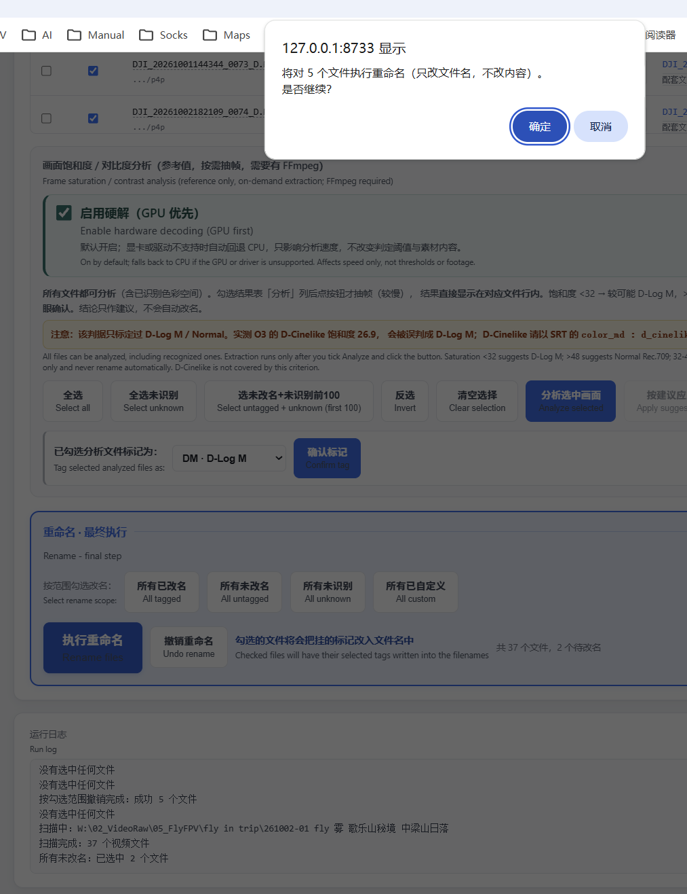
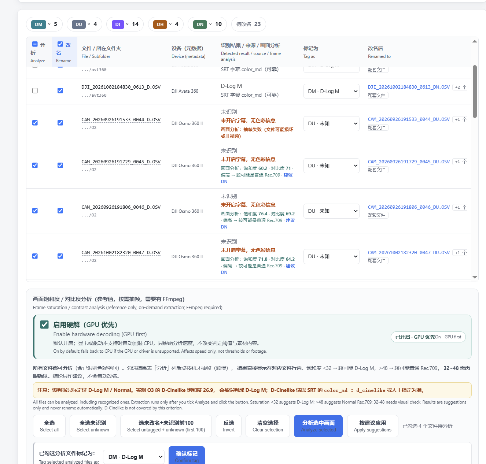

# DJI Footage Color Space Tagging Tool

Add a color tag to the end of DJI video filenames (`_D1` / `_D2` / `_DH` / `_DN` / `_DM` / `_DC` / `_DU`), so you can tell at a glance which color mode was used during post-production color grading.

> **The exe build is simpler**: unzip it into any folder and double-click the exe — all dependencies are bundled, so no software needs to be installed. Do not put it in a read-only location, for example `C:\Program Files` is read-only. The undo history `_history\` is written inside the exe folder; that folder must be writable or undo will fail.
>
> The **Python version is still recommended**: it lets your own AI modify the source code to fit your needs. The trade-off is that you install Python 3, Pillow and ffmpeg yourself.

Current version **v3.04.03** · Free and open source forever · GitHub: <https://github.com/KylinFPV/DJI_ColorSpace_Renamer>  
Bilibili / Douyin / Xiaohongshu / YouTube: [KylinFPV](https://space.bilibili.com/36780014)

Currently supported devices: <span style="color:#0f766e"><b>Osmo Pocket 4P</b></span> (camera body metadata); <span style="color:#1f6feb"><b>Avata 360 / Avata 2 / O4 Air Unit Pro / O3 Air Unit</b></span> (SRT subtitles); <span style="color:#b45309"><b>Osmo Pocket 3 / Action 2 / Osmo Nano / Osmo 360 II</b></span> (no color metadata; requires manual assignment or frame reference).


*Full interface: footage folder and scan options at the top; the results table below lists device, detection source, tag and renamed filename for each file.*

**Usage order (flowchart):**

```text
① Select analysis scope  →  ② Analyze  →  ③ Tag  →  ④ Select rename scope  →  ⑤ Rename by tag
```

---

## 1. What this tool does and does not do

Please read these four points first; the most important information is here:

1. **Only modifies filenames, without affecting identifiability.**  
   It only adds or changes a color tag at the end of the filename, for example `DJI_0151.MP4` → `DJI_0151_DM.MP4`; the original main name is kept unchanged, and duplicate tags like `_D11` will not appear.

2. **No internet access.**  
   The software runs only locally on your computer; it does not upload files, make network requests, or secretly report anything. The GitHub links in the interface open a browser to visit external websites only when you click them yourself.

3. **Does not alter the footage content.**  
   It does not modify the video frames, the metadata, or the file modification time. Scanning and recognition only "read files"; renaming only "changes filenames".

4. **ffmpeg is used only for frame analysis.**  
   Only when you actively click "Analyze Selected Frames" will the local ffmpeg extract a few frames to calculate saturation/contrast; it does not transcode, crop, merge, or export video. The extracted frames are computed in memory and discarded immediately; no intermediate files are generated, and nothing is written back to the footage.

> **Still not convinced?** You can give the entire extracted package to your AI and ask it to read the source code and answer:  
> "Does this tool really not access the internet? Does it not modify source file contents? Does it only modify filenames? Is ffmpeg used only for frame analysis?"

---

## 2. What software is needed and where to put it

### 1. Basic requirements

| Purpose | What's needed | Required? |
|---|---|---|
| Scanning, recognition, renaming | **Python 3** | Required |
| Frame analysis (optional) | **Pillow** + **ffmpeg** | Only needed when using frame analysis |

In other words: **ffmpeg is not needed for renaming alone; Pillow and ffmpeg are only needed for frame analysis.**

### 2. Recommended portable (no-install) setup

A simpler approach: after extracting to a location of your choice, have the AI **read README.md, confirm that the source code matches those four important points, and complete all the necessary steps**. Then you just need to double-click `启动start.bat` to use it.

The software already includes a `depend` folder by default, containing `readme_depend.md`, which explains in detail where each file should be placed and how to verify it. After extracting, arrange the files as follows:

```text
DJI_Color_Space\
├─ 启动start.bat
├─ app.py
├─ web\
└─ depend\
   ├─ readme_depend.md       ← Detailed dependency placement instructions
   ├─ python\
   │  └─ python.exe          ← Put Python here
   └─ ffmpeg.exe             ← Put ffmpeg here (or in depend\bin\)
```

`启动start.bat` will first look for `depend\python\python.exe`; "Frame Analysis" will first look for `depend\ffmpeg.exe` or `depend\bin\ffmpeg.exe`.

### 3. Official download methods

| Software | Download URL | How to place |
|---|---|---|
| Python | <https://www.python.org/downloads/windows/> | Download the Windows 64-bit installer. During installation, check **Add Python to PATH**; or copy the installed Python directory to `depend\python\`. |
| Pillow | After installing Python, run: `python -m pip install pillow` | If Python is in `depend\python\`, run: `depend\python\python.exe -m pip install pillow` |
| ffmpeg | <https://www.gyan.dev/ffmpeg/builds/> Download `ffmpeg-release-essentials.zip`; or <https://ffmpeg.org/download.html> | After extracting, copy `bin\ffmpeg.exe` to `depend\ffmpeg.exe` or `depend\bin\ffmpeg.exe`. |

If you don't need frame analysis, you can skip installing Pillow and ffmpeg entirely; scanning/renaming still works as usual.

### 4. Launch

Double-click `启动start.bat`. If it closes immediately or cannot find files after double-clicking, make sure you are opening it via a **mapped drive letter** (for example `W:\...\启动start.bat`), not directly through a UNC path like `\\server\share\...`.

The service only listens on `127.0.0.1`, so only this computer can access it.

---

## 3. Use in order

Recommended order: **Select analysis scope → Analyze → Tag → Select rename scope → Rename by tag**.

1. **Select analysis scope**: In the results table, check the "Analyze" column, or use buttons like "Select All Unrecognized" and "Select First 100 Unrenamed + Unrecognized" to quickly select.
2. **Analyze**: Click "Analyze Selected Frames". A scan must be done first; frame analysis requires FFmpeg, and the results are only suggestions - files will not be renamed automatically.
3. **Tag**: Choose a code in "Tag Checked Analyzed Files As" and click "Confirm Tag"; you can also directly change the "Tag As" dropdown in each row. Tagging only updates the preview.
4. **Select rename scope**: Use the "Rename" column header to select all, or the "All Renamed / Unrenamed / Unrecognized / Customized" buttons.
5. **Rename by tag**: Click "Execute Rename". If you make a mistake, you can use "Undo Rename" to revert the most recent rename within the checked scope.

Selecting a directory and scanning: Paste the footage folder into the path box, or click "Browse Folder...". The first time you open it, it will show the root of the drives; afterwards it will automatically remember the last location. Scan options: whether to include companion files with the same name, whether to include subfolders, and whether to skip already-tagged files.



*Clicking "Execute Rename" asks for confirmation first, and only filenames are changed. "Undo Rename" reverts the latest rename within the checked scope; the run log at the bottom records every scan and rename.*

---

## 4. Filename tag reference

| Color mode | Suffix | Color mode | Suffix |
|---|---|---|---|
| D-Log | `_D1` | D-Log M | `_DM` |
| D-Log 2 | `_D2` | D-Cinelike | `_DC` |
| HLG | `_DH` | Unknown | `_DU` |
| Standard Rec.709 / Normal | `_DN` | | |

There are three main sources of recognition: camera body metadata, color information in same-named `.SRT` subtitle files, and existing filename tags. When none are available, the file is tagged `_DU` (unknown); you can assign a tag manually or use frame analysis as a reference.

When an O3 air unit / Action 2 `DJI_xxxx.MP4` has no `_D` tag, a suffix is **appended**, for example `DJI_0006.MP4` → `DJI_0006_DN.MP4`; same-named companion files are renamed accordingly.

---

## 5. Frame saturation / contrast analysis (reference values, extract frames on demand, requires FFmpeg)



*Results are written into the "Detected result / source" column with a suggested tag; nothing is renamed automatically. GPU hardware decoding is used by default.*

- Frames are extracted only when you actively check the "Analyze" column and click "Analyze Selected Frames"; the results are only suggestions and will not rename files automatically.
- Saturation `<32` is more likely D-Log M; `>48` is more likely standard Rec.709; `32~48` needs visual confirmation.
- A maximum of **100** files can be analyzed at a time; use "Select First 100 Unrenamed + Unrecognized" to quickly select in bulk.
- Hardware decoding is enabled by default: it prioritizes GPU-accelerated frame extraction and automatically falls back to CPU when the GPU/driver does not support it; this only affects speed, not the detection result.
- Important limitation: The criteria have only been calibrated for D-Log M / Normal. In testing, O3's D-Cinelike is misidentified as D-Log M; please rely on `color_md : d_cinelike` in the SRT or assign the tag manually.

---

## 6. FAQ

| Issue | Solution |
|---|---|
| Recognition result is "Unknown" | Some models do not write color information; you need to enable "Video Subtitles" in DJI Fly / the flight goggles before recording, as it cannot be added afterward. Existing footage can be tagged manually or by referring to frame analysis. |
| Folder browser is blank on first open | The first open now lists the drive letters; afterwards it automatically enters the last used directory. |
| Frame analysis reports missing ffmpeg / Pillow | Follow section 2 to put `ffmpeg.exe` into `depend\`, and install Pillow with `depend\python\python.exe -m pip install pillow`. |
| System dialog freezes | Click "Cancel System Dialog", or use the built-in "Browse Folder..." browser instead. |
| What if I renamed incorrectly? | Use "Undo Rename" to revert the most recent rename within the current checked scope. |
| How to use on a different computer | Just copy the entire directory over; dependencies can be placed in `depend\` as well. |

---

## 7. For developers

- Version history is in `CHANGELOG.md`.
- Smoke test: `python -m unittest discover -s tests -q` (for JS syntax checking, you can set `NODE_BIN` to point to `node.exe`).
- Version rules: the last digit indicates a minor update; the middle two digits indicate noticeable feature differences, so check before upgrading; the first digit is the major version.

---

## Appendix: Open source information

This project is free and open source forever. Source code: <https://github.com/KylinFPV/DJI_ColorSpace_Renamer>  
Author: KylinFPV (Bilibili / Douyin / Xiaohongshu / YouTube).

**License**: This project is released under the [MIT License](LICENSE). You may use, copy, modify, merge, publish, distribute and sublicense it freely, provided the copyright and license notices are retained in all copies or substantial portions. The software is provided "as is", without warranty of any kind.
