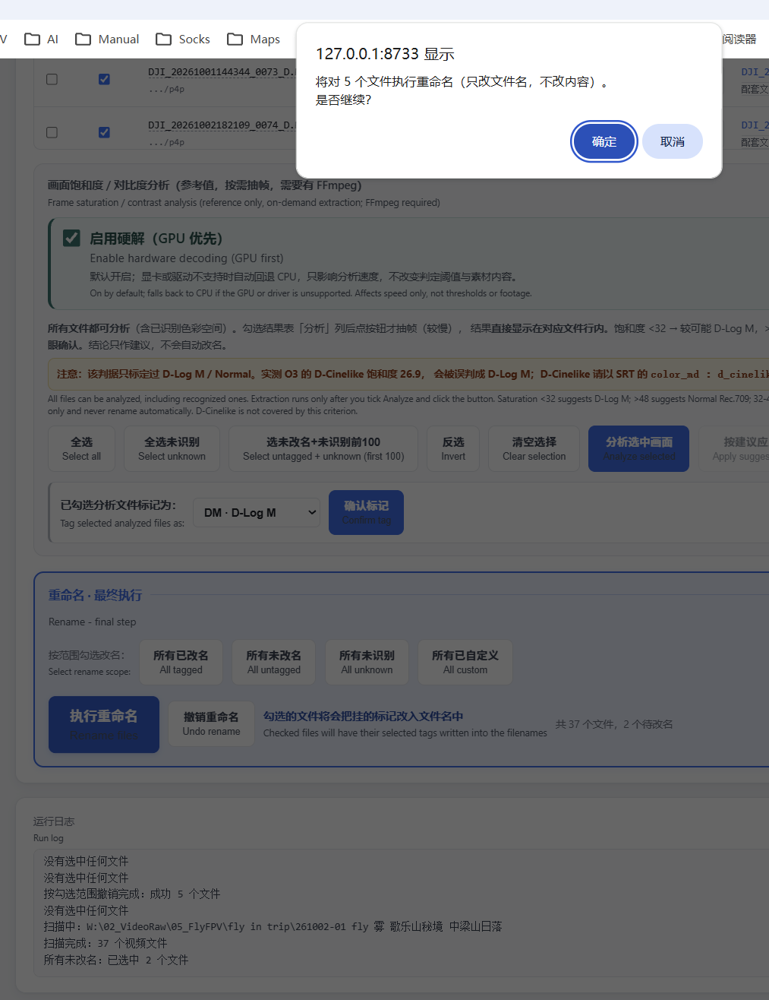
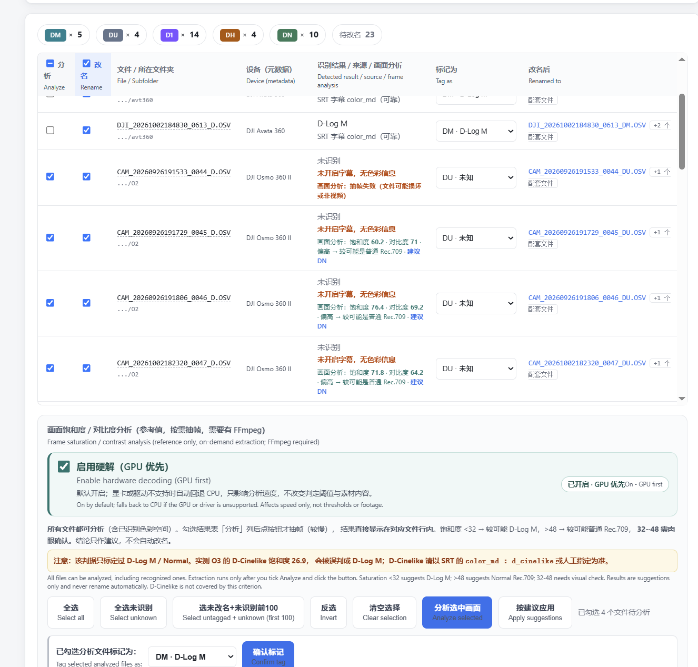

# DJI 素材色彩空间标记工具

**DJI Footage Color Space Tagging Tool** · 英文版 README 请往下翻（English version below ↓）

给 DJI 视频文件名末尾加上色彩标记（`_D1` / `_D2` / `_DH` / `_DN` / `_DM` / `_DC` / `_DU`），后期调色时一眼就能看出是哪一种色彩模式。

> **exe 版本更简单**：解压到任意文件夹，双击 exe 打开即用，已内置全部依赖，不用安装任何软件。请不要放在只读位置——`C:\Program Files` 就是只读的。撤销记录 `_history\` 写在 exe 所在目录内，目录需可写，否则撤销会失效。
>
> 仍然推荐大家使用 **Python 版本**：可以让你自己的 AI 按需求改源码。代价是要自己安装 Python 3 和 ffmpeg 等依赖。

当前版本 **v3.04.03**　·　永久免费开源　·　GitHub：<https://github.com/KylinFPV/DJI_ColorSpace_Renamer>  
B站 / 抖音 / 小红书 / YouTube：[KylinFPV](https://space.bilibili.com/36780014)

目前可识别设备：<span style="color:#0f766e"><b>Osmo Pocket 4P</b></span>（机身元数据）；<span style="color:#1f6feb"><b>Avata 360 / Avata 2 / O4 Air Unit Pro / O3 天空端</b></span>（SRT 字幕）；<span style="color:#b45309"><b>Osmo Pocket 3 / Action 2 / Osmo Nano / Osmo 360 II</b></span>（无色彩元数据，需手动指定或画面参考）。


*界面全貌：上方是素材目录与扫描选项，下方结果表按「设备 / 识别来源 / 标记 / 改名后」逐列展示，勾选后依次分析、标记、改名。*

**使用顺序（流程图）：**

```text
① 选择分析范围  →  ② 分析  →  ③ 标记  →  ④ 选择改名范围  →  ⑤ 按标记改名
```

---

## 一、这本工具会做什么，不会做什么

请先看这四条，最重要的信息都在这里：

1. **只会修改文件名，不影响辨认度。**  
   只在文件名末尾加或改色彩标记，例如 `DJI_0151.MP4` → `DJI_0151_DM.MP4`；原主名保持不变，也不会出现 `_D11` 这种重复标记。

2. **不上网。**  
   软件只在你的电脑本机运行，不上传文件、不联网请求、不偷偷上报。界面上的 GitHub 链接只有你自己点击时才会打开浏览器访问外部网站。

3. **不会改动素材内容。**  
   不修改视频画面、不修改元数据、不修改文件修改时间。扫描和识别只是“读文件”，改名只是“改文件名”。

4. **调用 ffmpeg 只用于画面分析。**  
   只有你主动点「分析选中画面」时，才会用本机 ffmpeg 抽几帧出来计算饱和度/对比度；不会转码、不裁剪、不合并、不导出视频。抽帧结果只在内存里算完就丢，不生成中间文件，也不写回素材。

> **还不放心？** 可以把整个解压包交给你的 AI，让它读源码后回答：  
> “这个工具是否真的不上网？是否不改源文件内容？是否只修改文件名？ffmpeg 是否只用于画面分析？”

---

## 二、需要什么软件，放在哪里

exe 版本已更新在 Releases 里，方便打开即用。解压到非系统目录即可用。但仍然推荐大家使用 Python 版本，可以按自己需求让 AI 修改和 debug。AI 万岁哈哈。

### 1. 基本要求

| 用途 | 需要什么 | 是否必须 |
|---|---|---|
| 扫描、识别、改名 | **Python 3** | 必须 |
| 画面分析（可选） | **Pillow** + **ffmpeg** | 只在用画面分析时需要 |

也就是说：**只改名不需要 ffmpeg；要用画面分析才需要 Pillow 和 ffmpeg。**

### 2. 推荐的绿色版放法

更简单的一个做法：解压到你喜欢的地方后，让 AI **读 README.md，确认源码符合那四条重要信息，并把该做的都做完**，然后你只要双击 `启动start.bat` 就能使用。

软件已经默认带一个 `depend` 文件夹，里面放了 `readme_depend.md`，详细说明每个文件该放在哪里、怎么验证。把软件解压后，按下面结构放置：

```text
DJI_Color_Space\
├─ 启动start.bat
├─ app.py
├─ web\
└─ depend\
   ├─ readme_depend.md       ← 依赖放置详细说明
   ├─ python\
   │  └─ python.exe          ← Python 放这里
   └─ ffmpeg.exe             ← ffmpeg 放这里（也可放 depend\bin\）
```

`启动start.bat` 会优先找 `depend\python\python.exe`；`画面分析` 会优先找 `depend\ffmpeg.exe` 或 `depend\bin\ffmpeg.exe`。

### 3. 官方下载方式

| 软件 | 下载地址 | 怎么放 |
|---|---|---|
| Python | <https://www.python.org/downloads/windows/> | 下载 Windows 64-bit installer。安装时勾选 **Add Python to PATH**；或把安装好的 Python 目录复制到 `depend\python\`。 |
| Pillow | 安装好 Python 后执行：`python -m pip install pillow` | 如果 Python 放在 `depend\python\`，执行：`depend\python\python.exe -m pip install pillow` |
| ffmpeg | <https://www.gyan.dev/ffmpeg/builds/> 下载 `ffmpeg-release-essentials.zip`；或 <https://ffmpeg.org/download.html> | 解压后把 `bin\ffmpeg.exe` 复制到 `depend\ffmpeg.exe` 或 `depend\bin\ffmpeg.exe`。 |

没有画面分析需求时，可以完全不装 Pillow 和 ffmpeg，扫描/改名照常可用。

### 4. 启动

双击 `启动start.bat`。如果双击后闪退或找不到文件，请确认是用**映射盘符**打开（例如 `W:\...\启动start.bat`），不要直接用 `\\服务器\共享\...` 这种 UNC 路径。

服务只监听 `127.0.0.1`，只有你这台电脑能访问。

---

## 三、按顺序使用

推荐顺序：**选择分析范围 → 分析 → 标记 → 选择改名范围 → 按标记改名**。

1. **选择分析范围**：在结果表勾选「分析」列，或用「全选未识别」「选未改名+未识别前100」等按钮快速勾选。
2. **分析**：点「分析选中画面」。需要先扫描；画面分析需要 FFmpeg，结果只作建议，不会自动改名。
3. **标记**：在「已勾选分析文件标记为」选好代码，点「确认标记」；也可以直接改每行「标记为」下拉。标记只更新预览。
4. **选择改名范围**：用表头「改名」全选，或「所有已改名 / 未改名 / 未识别 / 已自定义」按钮。
5. **按标记改名**：点「执行重命名」。改错了可以用「撤销重命名」按勾选范围撤回最近一次改名。

选目录与扫描：在路径框粘贴素材文件夹，或点「浏览文件夹…」。第一次打开会显示盘符根目录；之后会自动记住上次位置。扫描选项：是否带上同名配套文件、是否包含子文件夹、是否跳过已标记文件。



*点「执行重命名」会先弹出确认，只改文件名不改内容；改错了用「撤销重命名」按勾选范围撤回；底部运行日志逐条记录扫描与改名。

---

## 四、文件名标记对照

| 色彩模式 | 后缀 | 色彩模式 | 后缀 |
|---|---|---|---|
| D-Log | `_D1` | D-Log M | `_DM` |
| D-Log 2 | `_D2` | D-Cinelike | `_DC` |
| HLG | `_DH` | 未知 | `_DU` |
| 普通 Rec.709 / Normal | `_DN` | | |

识别来源主要有三类：机身元数据、同名 `.SRT` 字幕里的色彩信息、已有文件名标记。都没有时会标 `_DU`（未知），可以手动指定，或用画面分析作参考。

O3 天空端 / Action 2 的 `DJI_xxxx.MP4` 没有 `_D` 标记时，会**追加**后缀，例如 `DJI_0006.MP4` → `DJI_0006_DN.MP4`，同名配套文件同步改名。

---

## 五、画面饱和度 / 对比度分析（参考值，按需抽帧，需要有 FFmpeg）



*分析结果直接写在「识别结果 / 来源」列，末尾给出建议标记，不会自动改名；默认优先用显卡硬解抽帧。*

- 需要主动勾选「分析」列并点「分析选中画面」才会抽帧，结果只作建议，不会自动改名。
- 饱和度 `<32` 较可能是 D-Log M；`>48` 较可能是普通 Rec.709；`32~48` 需要肉眼确认。
- 单次最多分析 **100 个**文件；可用「选未改名+未识别前100」快速批量勾选。
- 硬解默认开启：优先用显卡加速抽帧，显卡/驱动不支持时自动回退 CPU；只影响速度，不改变判定结果。
- 重要限制：判据只对 D-Log M / Normal 做过标定。实测 O3 的 D-Cinelike 会被误判成 D-Log M，请以 SRT 里的 `color_md : d_cinelike` 或人工指定为准。

---

## 六、常见问题

| 问题 | 处理 |
|---|---|
| 识别结果是“未知” | 有些机型不写色彩信息；录制前需在 DJI Fly / 飞行眼镜开启「视频字幕」，事后补不了。已有素材可手动指定或按画面分析参考。 |
| 浏览文件夹第一次是空白 | 现在第一次打开会列出盘符；之后自动进入上次使用过的目录。 |
| 画面分析提示缺 ffmpeg / Pillow | 按第二章把 `ffmpeg.exe` 放进 `depend\`，并用 `depend\python\python.exe -m pip install pillow` 安装 Pillow。 |
| 系统对话框卡住 | 点「取消系统对话框」，或改用「浏览文件夹…」内置浏览器。 |
| 改错了怎么办 | 用「撤销重命名」，按当前勾选范围撤回最近一次改名。 |
| 换电脑怎么用 | 整个目录拷过去即可；依赖也可一起放在 `depend\`。 |

---

## 七、给开发者

- 版本记录见 `CHANGELOG.md`。
- 冒烟测试：`python -m unittest discover -s tests -q`（JS 语法检查可设置 `NODE_BIN` 指向 `node.exe`）。
- 版本规则：末位为小更新；中间两位为明显功能差异，升级前先确认；首位为主版本。

---

## 附录：开源信息

本项目永久免费开源。源码地址：<https://github.com/KylinFPV/DJI_ColorSpace_Renamer>  
作者：KylinFPV（B站 / 抖音 / 小红书 / YouTube）。

**许可证**：本项目采用 [MIT License（MIT 许可证）](LICENSE)。允许自由使用、复制、修改、合并、发布、分发及再许可，再分发时须保留版权声明与许可声明；软件按「原样」提供，不提供任何担保。

---
---

# DJI Footage Color Space Tagging Tool

**中文版 README 见上方**（Chinese version above ↑）

Add a color tag to the end of DJI video filenames (`_D1` / `_D2` / `_DH` / `_DN` / `_DM` / `_DC` / `_DU`), so you can tell at a glance which color mode was used during post-production color grading.

> **The exe build is simpler**: unzip it into any folder and double-click the exe — all dependencies are bundled, so no software needs to be installed. Do not put it in a read-only location, for example `C:\Program Files` is read-only. The undo history `_history\` is written inside the exe folder; that folder must be writable or undo will fail.
>
> The **Python version is still recommended**: it lets your own AI modify the source code to fit your needs. The trade-off is that you install Python 3, Pillow and ffmpeg yourself.

Current version **v3.04.03** · Free and open source forever · GitHub: <https://github.com/KylinFPV/DJI_ColorSpace_Renamer>  
Bilibili / Douyin / Xiaohongshu / YouTube: [KylinFPV](https://space.bilibili.com/36780014)

Currently supported devices: <span style="color:#0f766e"><b>Osmo Pocket 4P</b></span> (camera body metadata); <span style="color:#1f6feb"><b>Avata 360 / Avata 2 / O4 Air Unit Pro / O3 Air Unit</b></span> (SRT subtitles); <span style="color:#b45309"><b>Osmo Pocket 3 / Action 2 / Osmo Nano / Osmo 360 II</b></span> (no color metadata; requires manual assignment or frame reference).


*Full interface: footage folder and scan options at the top; the results table below lists device, detection source, tag and renamed filename for each file.*

**Usage order (flowchart):**

```text
① Select analysis scope  →  ② Analyze  →  ③ Tag  →  ④ Select rename scope  →  ⑤ Rename by tag
```

---

## 1. What this tool does and does not do

Please read these four points first; the most important information is here:

1. **Only modifies filenames, without affecting identifiability.**  
   It only adds or changes a color tag at the end of the filename, for example `DJI_0151.MP4` → `DJI_0151_DM.MP4`; the original main name is kept unchanged, and duplicate tags like `_D11` will not appear.

2. **No internet access.**  
   The software runs only locally on your computer; it does not upload files, make network requests, or secretly report anything. The GitHub links in the interface open a browser to visit external websites only when you click them yourself.

3. **Does not alter the footage content.**  
   It does not modify the video frames, the metadata, or the file modification time. Scanning and recognition only "read files"; renaming only "changes filenames".

4. **ffmpeg is used only for frame analysis.**  
   Only when you actively click "Analyze Selected Frames" will the local ffmpeg extract a few frames to calculate saturation/contrast; it does not transcode, crop, merge, or export video. The extracted frames are computed in memory and discarded immediately; no intermediate files are generated, and nothing is written back to the footage.

> **Still not convinced?** You can give the entire extracted package to your AI and ask it to read the source code and answer:  
> "Does this tool really not access the internet? Does it not modify source file contents? Does it only modify filenames? Is ffmpeg used only for frame analysis?"

---

## 2. What software is needed and where to put it

The exe build is now available in Releases — just unzip it into a non-system folder and open it to use. The Python version is still recommended, though, so your AI can modify and debug it to fit your needs. Long live AI, haha.

### 1. Basic requirements

| Purpose | What's needed | Required? |
|---|---|---|
| Scanning, recognition, renaming | **Python 3** | Required |
| Frame analysis (optional) | **Pillow** + **ffmpeg** | Only needed when using frame analysis |

In other words: **ffmpeg is not needed for renaming alone; Pillow and ffmpeg are only needed for frame analysis.**

### 2. Recommended portable (no-install) setup

A simpler approach: after extracting to a location of your choice, have the AI **read README.md, confirm that the source code matches those four important points, and complete all the necessary steps**. Then you just need to double-click `启动start.bat` to use it.

The software already includes a `depend` folder by default, containing `readme_depend.md`, which explains in detail where each file should be placed and how to verify it. After extracting, arrange the files as follows:

```text
DJI_Color_Space\
├─ 启动start.bat
├─ app.py
├─ web\
└─ depend\
   ├─ readme_depend.md       ← Detailed dependency placement instructions
   ├─ python\
   │  └─ python.exe          ← Put Python here
   └─ ffmpeg.exe             ← Put ffmpeg here (or in depend\bin\)
```

`启动start.bat` will first look for `depend\python\python.exe`; "Frame Analysis" will first look for `depend\ffmpeg.exe` or `depend\bin\ffmpeg.exe`.

### 3. Official download methods

| Software | Download URL | How to place |
|---|---|---|
| Python | <https://www.python.org/downloads/windows/> | Download the Windows 64-bit installer. During installation, check **Add Python to PATH**; or copy the installed Python directory to `depend\python\`. |
| Pillow | After installing Python, run: `python -m pip install pillow` | If Python is in `depend\python\`, run: `depend\python\python.exe -m pip install pillow` |
| ffmpeg | <https://www.gyan.dev/ffmpeg/builds/> Download `ffmpeg-release-essentials.zip`; or <https://ffmpeg.org/download.html> | After extracting, copy `bin\ffmpeg.exe` to `depend\ffmpeg.exe` or `depend\bin\ffmpeg.exe`. |

If you don't need frame analysis, you can skip installing Pillow and ffmpeg entirely; scanning/renaming still works as usual.

### 4. Launch

Double-click `启动start.bat`. If it closes immediately or cannot find files after double-clicking, make sure you are opening it via a **mapped drive letter** (for example `W:\...\启动start.bat`), not directly through a UNC path like `\\server\share\...`.

The service only listens on `127.0.0.1`, so only this computer can access it.

---

## 3. Use in order

Recommended order: **Select analysis scope → Analyze → Tag → Select rename scope → Rename by tag**.

1. **Select analysis scope**: In the results table, check the "Analyze" column, or use buttons like "Select All Unrecognized" and "Select First 100 Unrenamed + Unrecognized" to quickly select.
2. **Analyze**: Click "Analyze Selected Frames". A scan must be done first; frame analysis requires FFmpeg, and the results are only suggestions - files will not be renamed automatically.
3. **Tag**: Choose a code in "Tag Checked Analyzed Files As" and click "Confirm Tag"; you can also directly change the "Tag As" dropdown in each row. Tagging only updates the preview.
4. **Select rename scope**: Use the "Rename" column header to select all, or the "All Renamed / Unrenamed / Unrecognized / Customized" buttons.
5. **Rename by tag**: Click "Execute Rename". If you make a mistake, you can use "Undo Rename" to revert the most recent rename within the checked scope.

Selecting a directory and scanning: Paste the footage folder into the path box, or click "Browse Folder...". The first time you open it, it will show the root of the drives; afterwards it will automatically remember the last location. Scan options: whether to include companion files with the same name, whether to include subfolders, and whether to skip already-tagged files.


*Clicking "Execute Rename" asks for confirmation first, and only filenames are changed. "Undo Rename" reverts the latest rename within the checked scope; the run log at the bottom records every scan and rename.*

---

## 4. Filename tag reference

| Color mode | Suffix | Color mode | Suffix |
|---|---|---|---|
| D-Log | `_D1` | D-Log M | `_DM` |
| D-Log 2 | `_D2` | D-Cinelike | `_DC` |
| HLG | `_DH` | Unknown | `_DU` |
| Standard Rec.709 / Normal | `_DN` | | |

There are three main sources of recognition: camera body metadata, color information in same-named `.SRT` subtitle files, and existing filename tags. When none are available, the file is tagged `_DU` (unknown); you can assign a tag manually or use frame analysis as a reference.

When an O3 air unit / Action 2 `DJI_xxxx.MP4` has no `_D` tag, a suffix is **appended**, for example `DJI_0006.MP4` → `DJI_0006_DN.MP4`; same-named companion files are renamed accordingly.

---

## 5. Frame saturation / contrast analysis (reference values, extract frames on demand, requires FFmpeg)


*Results are written into the "Detected result / source" column with a suggested tag; nothing is renamed automatically. GPU hardware decoding is used by default.*

- Frames are extracted only when you actively check the "Analyze" column and click "Analyze Selected Frames"; the results are only suggestions and will not rename files automatically.
- Saturation `<32` is more likely D-Log M; `>48` is more likely standard Rec.709; `32~48` needs visual confirmation.
- A maximum of **100** files can be analyzed at a time; use "Select First 100 Unrenamed + Unrecognized" to quickly select in bulk.
- Hardware decoding is enabled by default: it prioritizes GPU-accelerated frame extraction and automatically falls back to CPU when the GPU/driver does not support it; this only affects speed, not the detection result.
- Important limitation: The criteria have only been calibrated for D-Log M / Normal. In testing, O3's D-Cinelike is misidentified as D-Log M; please rely on `color_md : d_cinelike` in the SRT or assign the tag manually.

---

## 6. FAQ

| Issue | Solution |
|---|---|
| Recognition result is "Unknown" | Some models do not write color information; you need to enable "Video Subtitles" in DJI Fly / the flight goggles before recording, as it cannot be added afterward. Existing footage can be tagged manually or by referring to frame analysis. |
| Folder browser is blank on first open | The first open now lists the drive letters; afterwards it automatically enters the last used directory. |
| Frame analysis reports missing ffmpeg / Pillow | Follow section 2 to put `ffmpeg.exe` into `depend\`, and install Pillow with `depend\python\python.exe -m pip install pillow`. |
| System dialog freezes | Click "Cancel System Dialog", or use the built-in "Browse Folder..." browser instead. |
| What if I renamed incorrectly? | Use "Undo Rename" to revert the most recent rename within the current checked scope. |
| How to use on a different computer | Just copy the entire directory over; dependencies can be placed in `depend\` as well. |

---

## 7. For developers

- Version history is in `CHANGELOG.md`.
- Smoke test: `python -m unittest discover -s tests -q` (for JS syntax checking, you can set `NODE_BIN` to point to `node.exe`).
- Version rules: the last digit indicates a minor update; the middle two digits indicate noticeable feature differences, so check before upgrading; the first digit is the major version.

---

## Appendix: Open source information

This project is free and open source forever. Source code: <https://github.com/KylinFPV/DJI_ColorSpace_Renamer>  
Author: KylinFPV (Bilibili / Douyin / Xiaohongshu / YouTube).

**License**: This project is released under the [MIT License](LICENSE). You may use, copy, modify, merge, publish, distribute and sublicense it freely, provided the copyright and license notices are retained in all copies or substantial portions. The software is provided "as is", without warranty of any kind.
